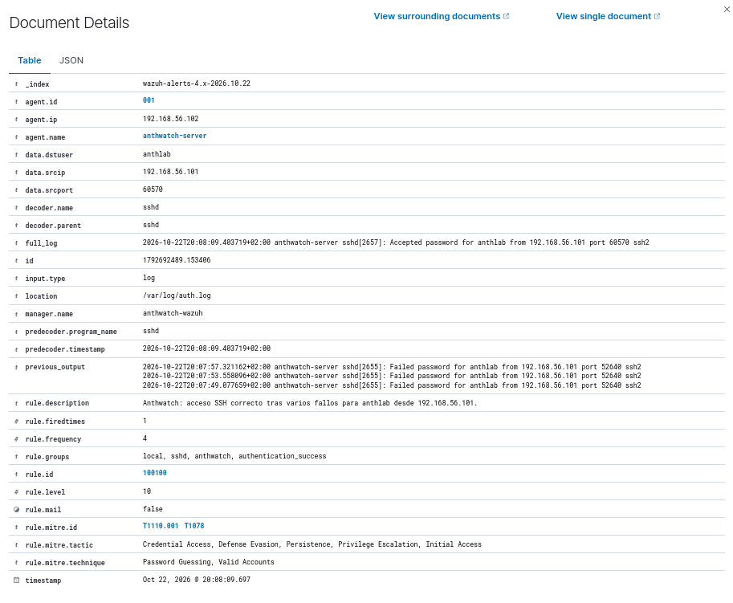

# Anthwatch

Laboratorio SOC con Wazuh: detección propia, validación y threat hunting sobre SSH y sudo.

Monté Anthwatch para empezar a familiarizarme con un SIEM y practicar tareas de un analista SOC. Además, estábamos trabajando con Wazuh en clase de Incidentes de Ciberseguridad y quería seguir practicando por mi cuenta. Mi objetivo era entender cómo llegan los registros, cómo se generan las alertas y cómo investigarlas usando mis propias máquinas.

Trabajo con Wazuh 4.14.9 y tres máquinas Ubuntu Server en VirtualBox. Empecé revisando fallos y accesos SSH, después probé una correlación con un usuario inexistente y acabé creando mi propia regla. En cada caso guardé evidencias, expliqué el resultado y redacté un ticket simulado. Todas las pruebas las hice con mis máquinas y cuentas del laboratorio.

Al probar la regla con conexiones reales apareció el problema de rsyslog: agrupaba los fallos y la secuencia que funcionaba en logtest dejaba de detectarse. Lo corregí y repetí las pruebas. Después amplié la investigación con un hunt de SSH y sudo, donde revisé la cobertura de las consultas y las repeticiones en los datos.

Este proyecto muestra cómo desplegué Wazuh, escribí y validé una regla propia, investigué problemas en los datos y conservé evidencias con hashes para poder comprobar los resultados.

*Mi regla `100100` detectando un acceso correcto después de tres fallos. La captura conserva el historial de intentos y el resultado de la prueba real.*

## Cómo leer este repositorio

- **2 minutos:** esta página y el resumen inicial del [caso 003](docs/casos/003-ssh-fallos-seguidos-de-exito.md), donde creé mi propia regla de detección.
- **10 minutos:** el [resumen del hunt](docs/hunts/001-ssh-y-sudo.md), su diagrama y el [análisis de duplicados](docs/hunts/hunt-001/repeticiones-exportacion.md): qué pregunté, cómo lo comprobé y qué quedó sin resolver.
- **Para consultar:** los informes completos, tickets, registros y hashes respaldan los resultados. No hace falta leer cada registro ni las 68 parejas para seguir la investigación.

## Casos completados

| ID | Regla | MITRE asociado | Resultado | Informe |
| --- | --- | --- | --- | --- |
| 001 | `5760`, `5715` | `T1110.001`, `T1021.004`; `T1078`, `T1021` | Fallos y acceso autorizado verificados; relación analizada manualmente | [Autenticación SSH](docs/casos/001-autenticacion-ssh.md) |
| 002 | `5710`, `5712` | `T1110` en la alerta correlacionada | Alerta de nivel 10; control de una conexión con dos `5710` y sin `5712` | [Intentos SSH repetidos](docs/casos/002-usuario-inexistente-repetido.md) |
| 003 | `100100` (propia) | `T1110.001`, `T1078` | Tres fallos + éxito en 23 s; revalidación con salidas completas y control temporal de 130 s | [Correlación SSH](docs/casos/003-ssh-fallos-seguidos-de-exito.md) |

## Threat hunting y revalidación

- [Hunt 001: SSH y sudo](docs/hunts/001-ssh-y-sudo.md): investigué qué ocurrió después de un acceso SSH y revisé la actividad con privilegios y las alertas repetidas.
- [Revalidación del caso 003](docs/casos/003-revalidacion.md): comprobé cuándo se activa mi regla y cuándo debe quedarse sin activar, cambiando el origen, el usuario y el tiempo entre intentos.
- [Evidencias del hunt](docs/evidencias/hunt-001/README.md) · [Evidencias de revalidación](docs/evidencias/revalidacion-003/README.md) · [HUNT-001](docs/tickets/HUNT-001.md).

Conservé los registros, las capturas y los hashes para comprobar los resultados.
La [investigación de alertas repetidas](docs/hunts/hunt-001/repeticiones-exportacion.md) confirmó copias posteriores a la emisión del manager; la causa concreta quedó sin resolver.

## Documentación

- [Estado, recursos y evidencias del montaje](docs/estado-del-laboratorio.md).
- [Arquitectura de red](docs/arquitectura/red-del-laboratorio.md) · [Instalación de Wazuh](docs/instalacion/wazuh.md).
- [Procedimiento de análisis N1](docs/playbooks/ssh-autenticacion.md) · [SOC-001](docs/tickets/SOC-001.md) · [SOC-002](docs/tickets/SOC-002.md) · [SOC-003](docs/tickets/SOC-003.md).
- [Regla propia](rules/anthwatch_ssh_rules.xml) · [Pruebas reproducibles](tests/caso-003/README.md).
- [Hoja de ruta y cobertura pendiente](docs/hoja-de-ruta.md).

[Portfolio](https://anthlab.github.io/) · [Licencia MIT](LICENSE)
