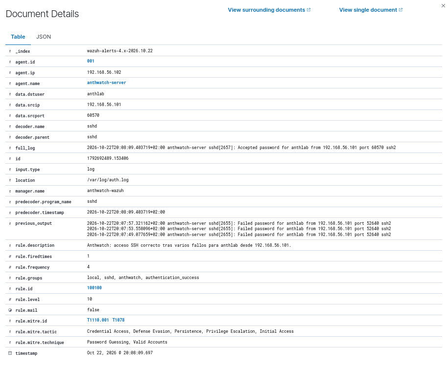

# Anthwatch

**Anthwatch** es un laboratorio SOC con Wazuh 4.14.9 y tres VMs Ubuntu donde practico detección, correlación y triaje de eventos.\
**Qué hice:** escribí reglas de correlación para SSH y un portal simulado, las validé con pruebas positivas y negativas y detecté y corregí un fallo de ingesta con tráfico real.\
**Qué demuestra:** análisis de logs, reglas propias, validación reproducible, triaje y documentación con evidencias verificables.\
**Empieza aquí:** [Caso 003 · Correlación SSH y diagnóstico de ingesta](docs/casos/003-ssh-fallos-seguidos-de-exito.md) (10 minutos).

*English: A Wazuh SOC lab covering detection, correlation and alert triage across three Ubuntu VMs.*\
*I built and tested custom rules, diagnosed a real log ingestion issue, and documented the results with verifiable evidence.*

**Procedencia:** los casos 004 y 005 proceden de ejercicios de clase adaptados a Anthwatch. El decodificador inicial del portal y los registros sintéticos fueron facilitados en clase; amplié la extracción de campos, completé las reglas y validé la integración en mis VMs.

*Prueba real de la regla SSH: acceso correcto después de tres fallos.*

## Casos completados

| ID | Regla | MITRE asociado | Qué demuestra | Resultado | Informe |
| --- | --- | --- | --- | --- | --- |
| 001 | `5760`, `5715` | Fallo: `T1110.001`, `T1021.004`. Éxito: `T1078`, `T1021`. | Análisis de logs y triaje contextual | Fallos y acceso autorizado verificados; relación analizada manualmente | [Autenticación SSH](docs/casos/001-autenticacion-ssh.md) |
| 002 | `5710`, `5712` | `T1110` en la alerta correlacionada | Validación de correlación y control de menor volumen | Alerta de nivel 10; control de una conexión con dos `5710` y sin `5712` | [Intentos SSH repetidos](docs/casos/002-usuario-inexistente-repetido.md) |
| 003 | `100100` (propia) | `T1110.001`, `T1078` | Regla propia, controles negativos y diagnóstico de ingesta | Tres fallos + éxito en 23 s; revalidación con salidas completas y control temporal de 130 s | [Correlación SSH](docs/casos/003-ssh-fallos-seguidos-de-exito.md) |
| 004 | `100110`, `100111`, `100112` (propias) | `T1110` en `100110` | Decodificación de aplicación y correlación por IP | Ráfaga de fallos, acceso posterior desde la misma IP y exportación externa verificados con registros de un portal simulado | [Portal de nóminas](docs/casos/004-portal-nominas.md) |
| 005 | `5503`, `5404`, `5901–5903`, `550`, `553`, `554` | `T1548.003` en la alerta `5404` | Triaje de cambios de archivos, cuentas y sudo | FIM en tiempo real, ciclo de una cuenta de prueba y fallos de sudo observados | [Cobertura y triaje](docs/casos/005-fim-usuarios-sudo.md) |

## Investigación y documentación

- [Hunt 001 · SSH y sudo](docs/hunts/001-ssh-y-sudo.md): informe principal y acceso a sus evidencias.
- [Índice de documentación](docs/README.md): casos, arquitectura, procedimientos y anexos.
- [Próximas prioridades](docs/hoja-de-ruta.md).

Cada informe principal enlaza sus pruebas, registros y capturas. Los detalles de revalidación y de duplicados quedan como material de apoyo.

## Cómo surgió el proyecto

Monté Anthwatch para empezar a familiarizarme con un SIEM y practicar tareas de un analista SOC. Además, estábamos trabajando con Wazuh en clase de Incidentes de Ciberseguridad y quería seguir practicando por mi cuenta. Mi objetivo era entender cómo llegan los registros, cómo se generan las alertas y cómo investigarlas usando mis propias máquinas.

Trabajo con Wazuh 4.14.9 y tres máquinas Ubuntu Server en VirtualBox. Empecé revisando fallos y accesos SSH, después probé una correlación con un usuario inexistente y acabé creando mi propia regla. Guardé evidencias e informes de los cinco casos y redacté tickets simulados para los casos 001–003. Todas las pruebas las hice con mis máquinas y cuentas del laboratorio.

Al probar la regla con conexiones reales apareció el problema de rsyslog: agrupaba los fallos y la secuencia que funcionaba en logtest dejaba de detectarse. Lo corregí y repetí las pruebas. Después amplié la investigación con un hunt de SSH y sudo, donde revisé la cobertura de las consultas y las repeticiones en los datos.

Los casos 004 y 005 nacieron de ejercicios de clase que adapté a Anthwatch. En el portal partí del decodificador inicial y de los registros sintéticos facilitados, amplié la extracción de campos y completé las reglas. Contrasté la cronología con las alertas del agente. Para el caso 005 generé cambios controlados de archivos y cuentas y fallos de sudo en mi servidor.

[Portfolio](https://anthlab.github.io/) · [Licencia MIT](LICENSE)
