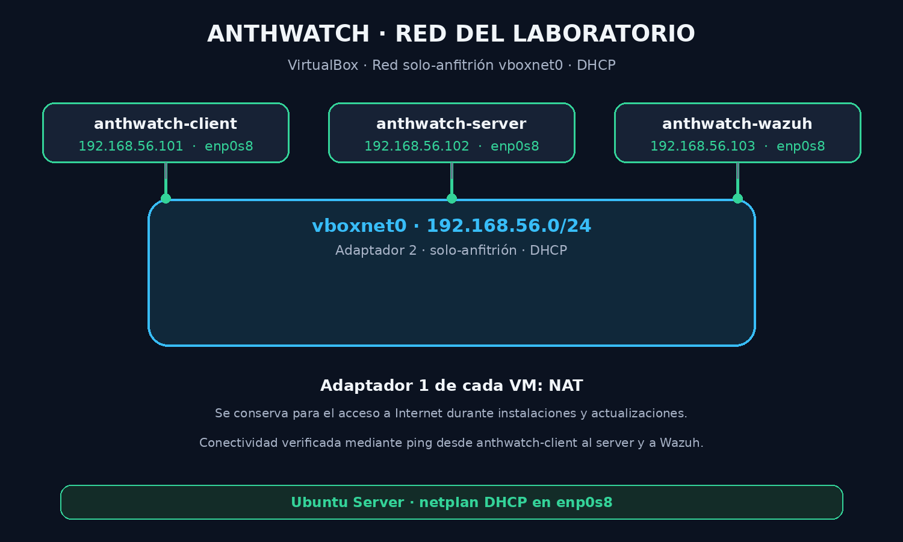
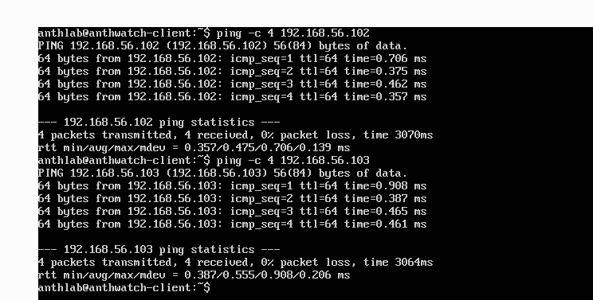

# Red del laboratorio

[Volver al README](../../README.md)

## Topología

Las tres máquinas virtuales están conectadas a la red solo-anfitrión **`vboxnet0`** de VirtualBox. En cada VM se conserva el **Adaptador 1 en NAT** y se usa el **Adaptador 2** para la red solo-anfitrión. En Ubuntu, las interfaces son `enp0s3` (NAT) y `enp0s8` (solo-anfitrión).

La red `vboxnet0` tiene DHCP habilitado. Ubuntu solicita una dirección para `enp0s8` mediante Netplan.



## Direcciones actuales

| Máquina | Interfaz de laboratorio | Dirección IPv4 actual |
| --- | --- | --- |
| `anthwatch-client` | `enp0s8` | `192.168.56.101/24` |
| `anthwatch-server` | `enp0s8` | `192.168.56.102/24` |
| `anthwatch-wazuh` | `enp0s8` | `192.168.56.103/24` |

Las direcciones se asignan por DHCP y corresponden a las concesiones observadas durante la configuración. Podrían cambiar si se renuevan las concesiones.

## Configuración de Netplan

En cada máquina se creó `/etc/netplan/60-host-only.yaml` con DHCP para `enp0s8`:

```yaml
network:
  version: 2
  ethernets:
    enp0s8:
      dhcp4: true
```

Para editar el archivo desde la consola de Ubuntu Server:

```bash
sudo nano /etc/netplan/60-host-only.yaml
```

Después de guardar el contenido, se ajustaron los permisos y se aplicó la configuración:

```bash
sudo chmod 600 /etc/netplan/60-host-only.yaml
sudo netplan generate
sudo netplan apply
ip -br -4 addr
```

La dirección de `enp0s8` se comprobó con `ip -br -4 addr`. La conectividad entre las máquinas se verificó con `ping` desde `anthwatch-client` hacia `anthwatch-server` (`192.168.56.102`) y `anthwatch-wazuh` (`192.168.56.103`), recibiendo respuestas.

## Comprobación de conectividad

Desde `anthwatch-client`:

```bash
ping -c 4 192.168.56.102
ping -c 4 192.168.56.103
```

Una respuesta a los pings confirma la comunicación IP entre el cliente y los otros dos equipos en la red del laboratorio.

## Evidencia

La captura muestra cuatro respuestas de cada máquina, sin pérdida de paquetes:


