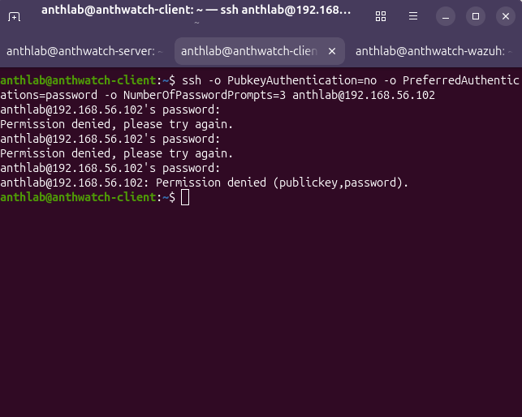
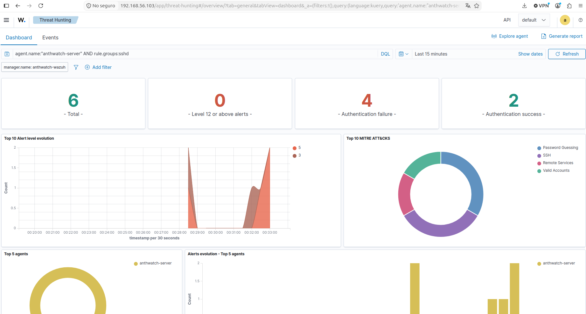
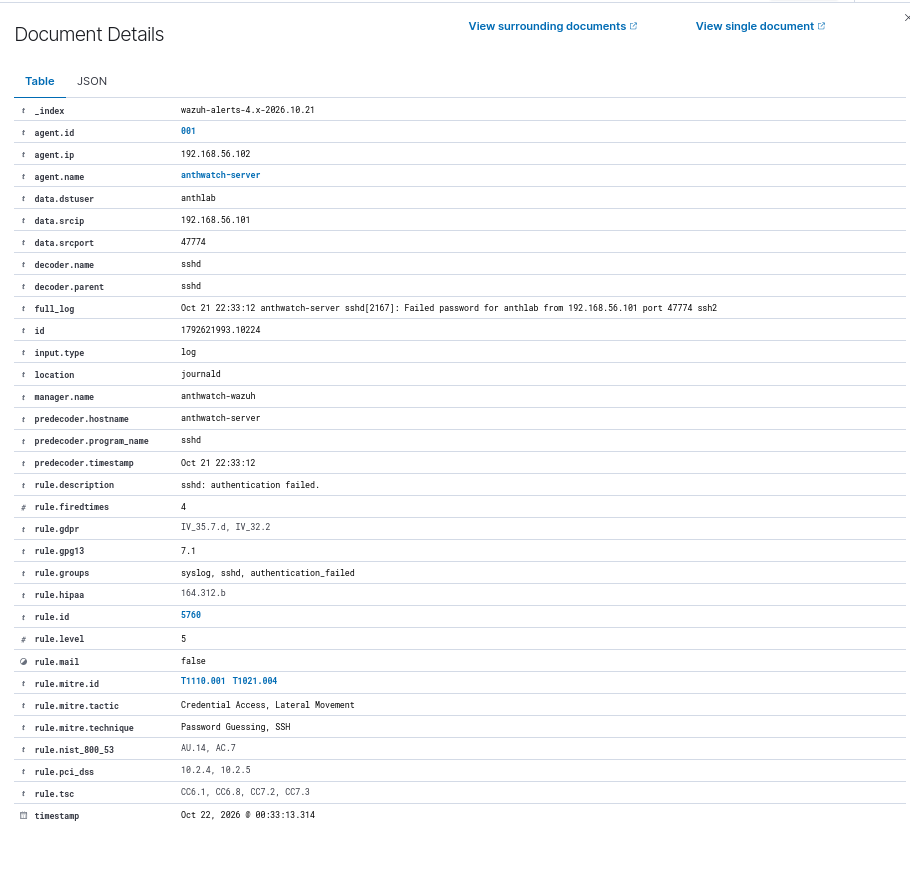
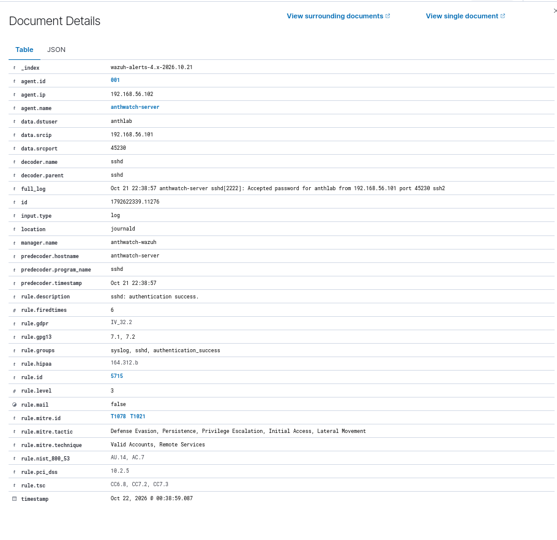

# Caso 001 · Fallos de autenticación SSH y acceso correcto

[Volver al README](../../README.md)

**Fecha:** 22 de octubre de 2026, según el dashboard.  
**Estado:** prueba controlada completada; recogida de eventos SSH validada.  
**Clasificación:** actividad autorizada del laboratorio.  
**Prioridad del caso:** baja, por tratarse de una simulación conocida.

## Objetivo y alcance

Comprobar que Wazuh recibe los registros de autenticación SSH de `anthwatch-server`, distingue un fallo de un acceso correcto y permite identificar el equipo de origen y el usuario.

Desde `anthwatch-client` se introdujo una contraseña incorrecta tres veces y, después, se inició una nueva conexión con la contraseña correcta. El usuario del laboratorio fue `anthlab` en ambos casos. No se utilizaron herramientas de fuerza bruta ni listas de contraseñas.

| Componente | Dirección | Papel |
| --- | --- | --- |
| `anthwatch-client` | `192.168.56.101` | Origen de las conexiones SSH |
| `anthwatch-server` | `192.168.56.102` | Servidor SSH monitorizado, agente `001` |
| `anthwatch-wazuh` | `192.168.56.103` | Recepción, análisis y consulta de los eventos |

El entorno utiliza Ubuntu Server 24.04.5 LTS y Wazuh 4.14.9. Los eventos examinados indican `location: journald` y el decodificador `sshd`.

## Procedimiento realizado

### 1. Intentos con contraseña incorrecta

Dentro de la sesión SSH de `anthwatch-client`, se ejecutó:

```bash
ssh -o PubkeyAuthentication=no -o PreferredAuthentications=password -o NumberOfPasswordPrompts=3 anthlab@192.168.56.102
```

Se introdujo una contraseña incorrecta en las tres solicitudes. La terminal mostró dos mensajes `Permission denied, please try again.` y terminó con `Permission denied (publickey,password).`, devolviendo el control a la consola del cliente.



### 2. Búsqueda en Wazuh

En **Threat Hunting** se seleccionaron los últimos 15 minutos y se aplicó el filtro:

```text
agent.name:"anthwatch-server" AND rule.groups:sshd
```

El panel de esa ventana temporal mostró seis eventos: cuatro de fallo y dos de autenticación correcta. Estos contadores incluyen toda la actividad que coincide con el filtro en ese intervalo; no se interpretan como el número exacto de contraseñas introducidas en la conexión de prueba.



Se abrió **Events** y se examinó un fallo reciente. Sus campos confirmaron el origen `192.168.56.101`, el destino monitorizado `anthwatch-server` y el usuario `anthlab`.

### 3. Acceso con contraseña correcta

Desde el mismo cliente se inició una nueva conexión, esta vez con la contraseña correcta:

```bash
ssh -o PubkeyAuthentication=no -o PreferredAuthentications=password anthlab@192.168.56.102
```

La prueba indicaba comprobar el nombre del equipo con `hostname` y salir con `exit`. No se conserva una captura de la ejecución de esos dos comandos. El acceso correcto sí queda confirmado por el registro `Accepted password` de Wazuh.

## Cronología y evidencias

Las horas de la siguiente tabla corresponden al campo `timestamp` tal como aparece en el dashboard.

| Fecha y hora mostrada | Evento examinado | Origen y usuario | Regla | Nivel |
| --- | --- | --- | --- | ---: |
| 22/10/2026 00:33:13.314 | Contraseña rechazada | `192.168.56.101`, `anthlab` | `5760` — `sshd: authentication failed.` | 5 |
| 22/10/2026 00:38:59.087 | Contraseña aceptada | `192.168.56.101`, `anthlab` | `5715` — `sshd: authentication success.` | 3 |

### Fallo de autenticación

Fragmento de `full_log` transcrito de la captura:

```text
Oct 21 22:33:12 anthwatch-server sshd[2167]: Failed password for anthlab from 192.168.56.101 port 47774 ssh2
```



### Autenticación correcta

Fragmento de `full_log` transcrito de la captura:

```text
Oct 21 22:38:57 anthwatch-server sshd[2222]: Accepted password for anthlab from 192.168.56.101 port 45230 ssh2
```



Los mensajes originales muestran el 21 de octubre a las 22:xx y el dashboard el 22 de octubre a las 00:xx. El desfase de dos horas es compatible con UTC frente a Europe/Madrid en esa fecha, pero las capturas no prueban por sí solas la configuración horaria de cada componente. Además, `full_log` contiene la hora del mensaje original y `timestamp` la del evento en Wazuh; no se deben equiparar sus segundos ni interpretar el desfase como un retraso de dos horas.

## Análisis

Los dos eventos seleccionados tienen el mismo origen y el mismo usuario, y se registran en el agente del servidor. Esto permite reconstruir una secuencia de fallo seguida de acceso correcto. Los distintos puertos de origen y procesos `sshd` son coherentes con conexiones distintas.

La regla `5760`, de nivel 5, identifica el fallo. La regla `5715`, de nivel 3, identifica el acceso correcto. Los niveles son los valores de las reglas observadas; la prioridad del caso se valora además con el contexto de la prueba.

La captura del fallo contiene `rule.firedtimes: 4` y la del acceso correcto `rule.firedtimes: 6`. No se usan esos valores como conteo de intentos de una conexión concreta.

### Etiquetas MITRE ATT&CK observadas

| Evento | Etiquetas presentes en la captura | Interpretación en este caso |
| --- | --- | --- |
| Fallo | `T1110.001` — Password Guessing; `T1021.004` — SSH | Metadatos de la regla, compatibles con el uso de SSH y la prueba de contraseñas incorrectas |
| Acceso correcto | `T1078` — Valid Accounts; `T1021` — Remote Services | Metadatos de la regla; el acceso realizado fue autorizado |

Las etiquetas no demuestran que se hayan producido todas las tácticas que enumera la regla. En particular, un acceso correcto no confirma el uso malicioso de una cuenta válida.

## Conclusión y límites

La prueba valida la recogida y el análisis de registros SSH: Wazuh muestra un fallo de contraseña y un acceso correcto, ambos del cliente al servidor y con el usuario esperado.

No se confirma una cuenta comprometida, un ataque real ni una alerta correlacionada de fuerza bruta. La relación entre los dos eventos se estableció al revisarlos manualmente; no se ha validado una regla que detecte específicamente «fallos seguidos de éxito».

La evidencia incluye una terminal con tres solicitudes fallidas, una vista general y el detalle de un fallo y de un acceso correcto. No se dispone de una exportación completa de los eventos, por lo que no se reconstruye cada fallo individual ni se atribuyen todos los contadores del panel a esta prueba. Tampoco se conservó evidencia del estado del adaptador NAT durante la ejecución.

## Decisión y respuesta propuesta

Se cierra la validación como actividad autorizada del laboratorio, sin medidas de contención.

En un entorno real, antes de cerrar una secuencia similar se comprobarían la autorización del acceso, la procedencia de la IP, el historial del usuario y la actividad posterior. Se escalaría si el usuario niega el acceso, el origen no es esperado o aparecen acciones sospechosas. Según los hallazgos, se propondrían medidas sobre la cuenta, las sesiones y el origen de la conexión.

## Próximos pasos

- Validar en una prueba aparte la detección correlacionada de varios fallos y documentar el umbral observado.
- Conservar una exportación de los eventos y comprobar las zonas horarias para facilitar futuras cronologías.
- Continuar con una prueba de integridad de archivos.
