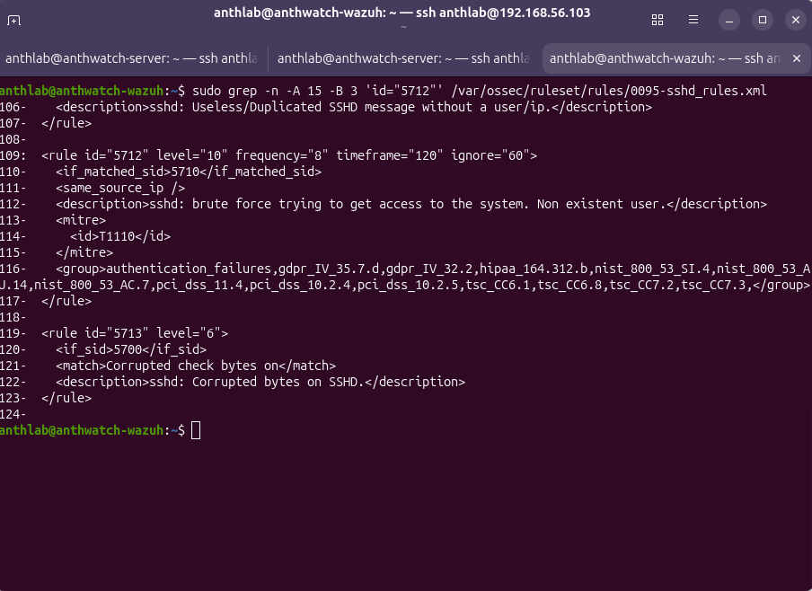
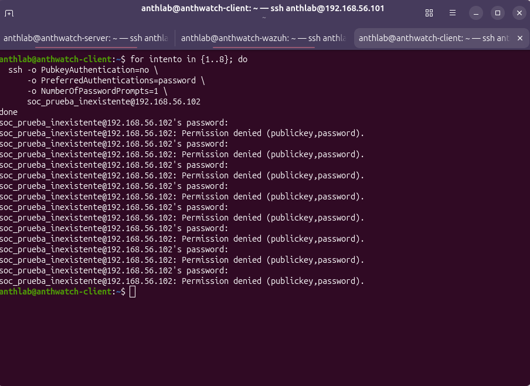
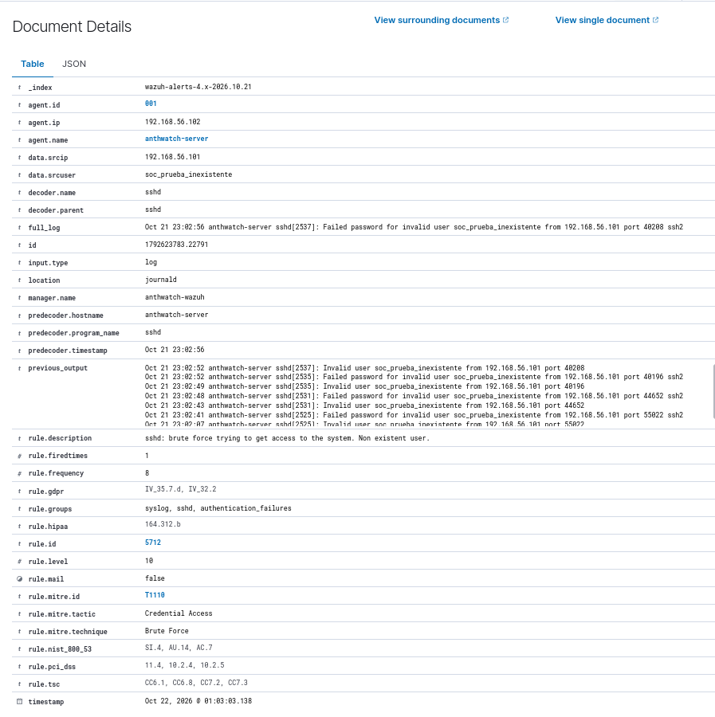
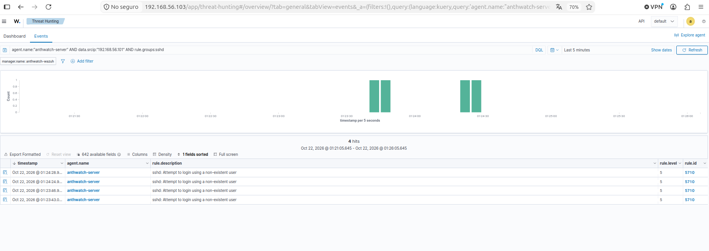
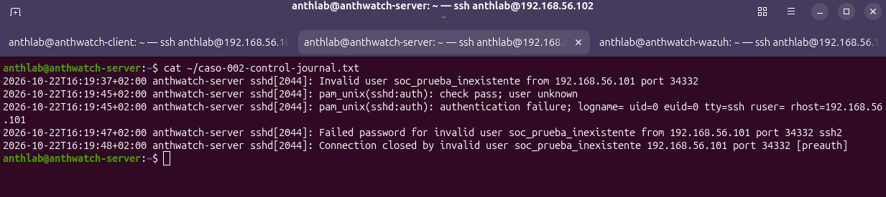
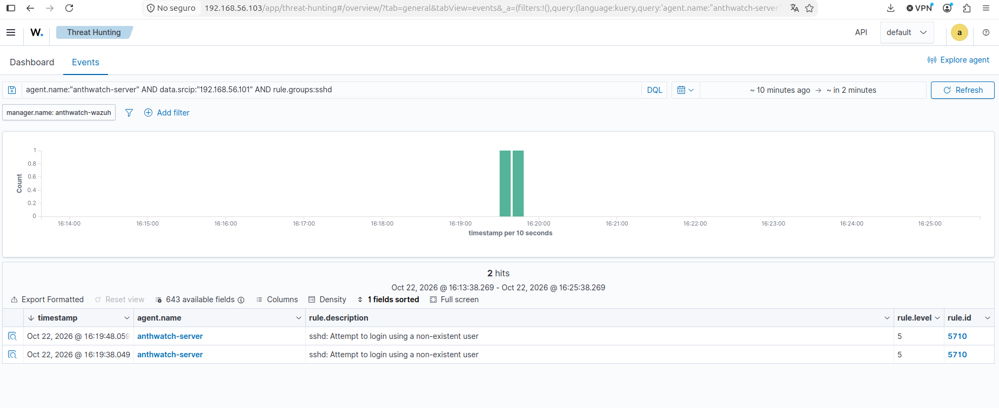
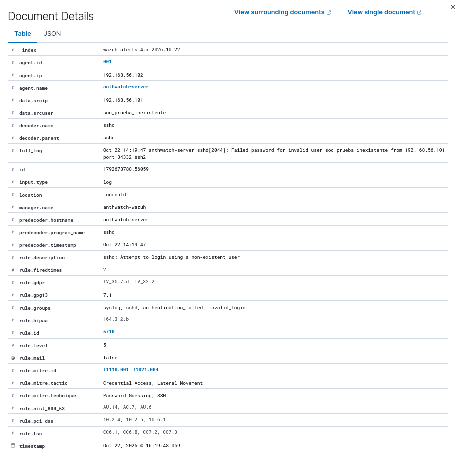

# Caso 002 · Correlación de intentos SSH con usuario inexistente

[Volver al README](../../README.md)

Detecté intentos SSH repetidos contra una cuenta inexistente con la regla `5712`, nivel 10.  
Validé la alerta tras ocho conexiones de prueba y repetí el control: una conexión atribuida en journal produjo dos eventos `5710`, sin `5712`.  
Aprendí a distinguir conexiones, registros de autenticación y condiciones de correlación.

**Fecha:** 22/10/2026, según el dashboard.  
**Estado:** detección correlacionada y control adicional de una conexión validados.  
**Clasificación:** simulación autorizada en el laboratorio.  
**Resultado:** alerta `5712`, nivel 10, y eventos individuales `5710` sin nueva `5712` en la ventana de control.

## Objetivo y alcance

Quería pasar de revisar eventos individuales a comprobar una correlación automática. Probé accesos repetidos con una cuenta inexistente y comparé el resultado con un control de menor volumen.

| Componente | Dirección | Función |
| --- | --- | --- |
| `anthwatch-client` | `192.168.56.101` | Origen de los intentos |
| `anthwatch-server` | `192.168.56.102` | Servidor SSH, agente `001` |
| `anthwatch-wazuh` | `192.168.56.103` | Manager, indexador y dashboard |

Usé Wazuh 4.14.9 sobre Ubuntu Server 24.04.5 LTS. La cuenta de la prueba fue `soc_prueba_inexistente`. Los registros de SSH la identifican como usuario no válido. Es un escenario distinto del [caso 001](001-autenticacion-ssh.md), que utilizó la cuenta existente `anthlab`.

## Regla revisada

En `anthwatch-wazuh` consulté la regla instalada:

```bash
sudo grep -n -A 15 -B 3 'id="5712"' /var/ossec/ruleset/rules/0095-sshd_rules.xml
```

La captura muestra estos parámetros:

| Parámetro | Valor y significado |
| --- | --- |
| ID | `5712` |
| Nivel | `10` |
| `if_matched_sid` | `5710`: eventos de acceso con usuario inexistente |
| `frequency` | `8`: umbral de eventos coincidentes |
| `timeframe` | `120` segundos |
| `same_source_ip` | Los eventos deben compartir IP de origen |
| `ignore` | `60` segundos tras activarse, para limitar repeticiones |
| MITRE | `T1110` — Brute Force |



El umbral cuenta eventos de log: una conexión puede generar tanto un registro de usuario inválido como otro de contraseña rechazada. La correlación agrupa por IP de origen.

## Procedimiento

### 1. Prueba de actividad repetida

Quería comprobar en `anthwatch-server` que la cuenta no existía, pero no conservé la salida de `getent`:

```bash
getent passwd soc_prueba_inexistente
```

Los mensajes posteriores `invalid user` identifican la cuenta como inexistente durante la prueba.

En `anthwatch-client` ejecuté este bloque e introduje una contraseña inventada en cada solicitud:

```bash
for intento in {1..8}; do
  ssh -o PubkeyAuthentication=no -o PreferredAuthentications=password -o NumberOfPasswordPrompts=1 soc_prueba_inexistente@192.168.56.102
done
```

La terminal muestra ocho solicitudes de contraseña y ocho resultados `Permission denied (publickey,password).`.



### 2. Consulta de la alerta correlacionada

En **Threat Hunting → Events** busqué:

```text
agent.name:"anthwatch-server" AND rule.id:5712
```

Abrí la alerta y revisé origen, agente, usuario, regla y los mensajes de `previous_output`.

### 3. Control posterior de menor volumen

Para separar el control de la prueba anterior, tomé como referencia una espera de más de dos minutos desde el último intento. Abrí una conexión con una contraseña inventada:

```bash
ssh -o PubkeyAuthentication=no -o PreferredAuthentications=password -o NumberOfPasswordPrompts=1 soc_prueba_inexistente@192.168.56.102
```

El dashboard conserva cuatro registros repartidos en dos pares temporales. Los guardé como control histórico de menor volumen y después repetí la prueba con journal para atribuir una conexión.

Consulté los últimos cinco minutos con:

```text
agent.name:"anthwatch-server" AND data.srcip:"192.168.56.101" AND rule.groups:sshd
```

## Resultados y evidencias

### Alerta correlacionada

**Revisión posterior:** la ejecución original de las 01:02–01:03 cae en una franja con documentos duplicados: identifiqué 15 parejas `5710` y una `5712`. La captura muestra lo que había entonces; al repetir hoy la consulta pueden aparecer recuentos distintos. El control de las 01:23–01:24 y la repetición de las 16:19 quedan fuera de esa franja. Véase la [revisión de duplicados](../hunts/hunt-001/repeticiones-exportacion.md).

| Campo observado | Valor |
| --- | --- |
| `timestamp` mostrado | 22/10/2026 01:03:03.138 |
| `agent.name` / `agent.ip` | `anthwatch-server` / `192.168.56.102` |
| `data.srcip` | `192.168.56.101` |
| `data.srcuser` | `soc_prueba_inexistente` |
| `rule.id` / `rule.level` | `5712` / `10` |
| `rule.frequency` | `8` |
| `rule.firedtimes` | `1` en el documento examinado |
| `rule.description` | `sshd: brute force trying to get access to the system. Non existent user.` |
| `location` / `decoder.name` | `journald` / `sshd` |
| `rule.mitre.id` | `T1110` |

Fragmento de `full_log` transcrito de la captura:

```text
Oct 21 23:02:56 anthwatch-server sshd[2537]: Failed password for invalid user soc_prueba_inexistente from 192.168.56.101 port 40208 ssh2
```



El campo `previous_output` conserva los registros anteriores de usuario inválido y contraseña rechazada que contextualizan la alerta.

### Control histórico de menor volumen

La captura conserva la ventana **22/10/2026 01:21:05.645–01:26:05.645**, según el dashboard. Aparecen cuatro resultados, todos de la regla `5710`, nivel 5:

| Hora aproximada mostrada | Regla | Descripción |
| --- | --- | --- |
| 01:23:43 | `5710` | Intento de acceso con usuario inexistente |
| 01:23:46 | `5710` | Intento de acceso con usuario inexistente |
| 01:24:24 | `5710` | Intento de acceso con usuario inexistente |
| 01:24:28 | `5710` | Intento de acceso con usuario inexistente |

Los milisegundos de las filas aparecen truncados. No se observa una nueva `5712` en esa consulta, que sí incluye todos los eventos SSH del agente y origen indicados en el intervalo.



### Control adicional: una conexión atribuida en journal

El 22/10/2026 repetí el control con una sola solicitud de contraseña. Recogí el journal de SSH en `anthwatch-server`, lo guardé con `tee` en `~/caso-002-control-journal.txt` y lo revisé con `cat`. El apartado [Repetir el control](#repetir-el-control) reúne el procedimiento.

| Hora del journal (`+02:00`) | Mensaje | Proceso y origen |
| --- | --- | --- |
| 16:19:37 | Usuario inexistente | `sshd[2044]`, `.101:34332` |
| 16:19:45 | Comprobación PAM y fallo de autenticación | `sshd[2044]` |
| 16:19:47 | Contraseña rechazada | `sshd[2044]`, `.101:34332` |
| 16:19:48 | Conexión cerrada antes de autenticarse | `sshd[2044]`, `.101:34332` |

El proceso, la IP y el puerto se mantienen desde la identificación del usuario hasta el cierre: los mensajes se atribuyen a **una conexión**, con un fallo de contraseña. El journal contiene cinco registros en total, incluidos dos mensajes PAM.



Copié el [journal original de cinco líneas](../evidencias/caso-002-control-journal.txt) con `scp` y lo conservé sin modificarlo. Su [procedencia y contraste horario](../evidencias/README.md) se documentan junto con las salidas de `timedatectl`.

En Wazuh busqué:

```text
agent.name:"anthwatch-server" AND data.srcip:"192.168.56.101" AND rule.groups:sshd
```

Con el filtro adicional `manager.name: anthwatch-wazuh`, la ventana visible **22/10/2026 16:13:38.269–16:25:38.269** devuelve exactamente dos resultados:

| Hora del dashboard | Regla | Nivel |
| --- | --- | ---: |
| 16:19:38.049 | `5710` | 5 |
| 16:19:48.059 | `5710` | 5 |

**Resultado del control:** una conexión, dos eventos individuales `5710` y ninguna alerta `5712` en la consulta conservada. El detalle del segundo evento coincide con el journal en usuario, origen, puerto y PID. El control valida la distinción entre número de registros y número de conexiones.





El journal muestra `16:19:47+02:00`, mientras `full_log` conserva `14:19:47` y el dashboard `16:19:48.059`. El código del colector de Wazuh 4.14.9 confirma el uso de UTC mediante `gmtime_r`; `14:19:47` equivale a `16:19:47+02:00`. Véase la [explicación horaria](../evidencias/README.md#representación-horaria-de-journald-en-wazuh-4149). Se mantienen las representaciones originales.

## Análisis

Comprobé que `5712` correlacionaba los eventos de usuario inexistente desde el mismo origen. En el caso 001 había revisado eventos individuales; aquí pude examinar una alerta con su historial.

En el control adicional seguí una conexión por PID, IP y puerto en el journal. Esa conexión produjo dos `5710` y ninguna nueva `5712` en la ventana conservada. Así comprobé en los registros la diferencia entre una conexión y los eventos que genera.

La alerta detectó el patrón que había generado. La clasifiqué como detección correcta de una simulación autorizada. El nivel 10 corresponde a la regla; asigné prioridad baja al caso por el contexto conocido.

## Límites

El control histórico de cuatro eventos queda separado del control atribuido por journal. Conservé capturas, el journal original y las tres salidas horarias; falta la exportación completa del índice. El control valida el intento aislado descrito, sin medir una tasa general de falsos positivos ni todos los escenarios de carga.

Las capturas conservan las horas anteriores al ajuste realizado antes del caso 003: mensaje original a las 23:02 y dashboard a las 01:03. La cronología histórica se mantiene sin alterarla. Véase [configuración horaria](../estado-del-laboratorio.md#configuración-horaria).

La captura inicial de `previous_output` es parcial y falta la salida de `getent`; los registros `invalid user` respaldan el estado de la cuenta. La regla agrupa por IP, sin exigir el mismo usuario. La causa del fallo del indexador descrito abajo quedó sin determinar; su relación con la prueba SSH y una posible pérdida de eventos siguen sin verificar.

## Incidencia operativa durante la consulta

Encontré `wazuh-indexer.service` en estado `failed`. Reinicié el servicio y revisé sus registros: seguía cargando componentes en `activating/start`. Dejé avanzar el arranque y recuperé el acceso al dashboard.

## Decisión N1

Cerré el caso como simulación autorizada, con la detección y el control posterior documentados. No apliqué contención ni hice un escalado real.

En una investigación real comprobaría el origen, otras cuentas o servidores afectados y posibles accesos correctos posteriores. Escalaría si el origen no se puede justificar, la actividad persiste o aparecen indicios de acceso no autorizado.

- [Ticket simulado SOC-002](../tickets/SOC-002.md).
- [Procedimiento N1 de análisis SSH](../playbooks/ssh-autenticacion.md).

## Repetir el control

### 1. Marcar el inicio en el servidor

Dejar pasar más de tres minutos desde el último intento de la prueba anterior. En una terminal SSH de `anthwatch-server` que se mantendrá abierta durante todo el control:

```bash
inicio_control=$(date --iso-8601=seconds)
printf '%s\n' "$inicio_control"
```

### 2. Ejecutar una única conexión desde el cliente

En `anthwatch-client`, ejecutar una sola vez e introducir una contraseña inventada:

```bash
ssh -o PubkeyAuthentication=no -o PreferredAuthentications=password -o NumberOfPasswordPrompts=1 soc_prueba_inexistente@192.168.56.102
```

Conservar la salida de la terminal. El resultado esperado es una solicitud de contraseña y `Permission denied`.

### 3. Exportar el journal en la misma terminal del servidor

```bash
fin_control=$(date --iso-8601=seconds)
sudo journalctl -u ssh --since "$inicio_control" --until "$fin_control" --output=short-iso --no-pager | tee caso-002-control-journal.txt
```

Conservar `caso-002-control-journal.txt`, incluidos los mensajes de apertura y cierre que existan. Anotar el inicio y el fin de la nueva prueba en su informe. Si `-u ssh` no devuelve registros de la prueba, comprobar la unidad y la fuente reales; una salida vacía no valida el control.

### 4. Contar y contrastar

Identificar los mensajes de `soc_prueba_inexistente` desde `192.168.56.101`. Agrupar por proceso SSH y por IP/puerto de origen, revisando apertura y cierre cuando estén disponibles. El usuario inválido y el fallo de contraseña pueden pertenecer a una misma conexión: no contar cada línea como conexión nueva. Una única ejecución con un prompt debe poder atribuirse a una conexión en la ventana recogida; si aparecen más, describirlas y repetir el control aislado.

En Wazuh, consultar ese mismo intervalo con margen para la ingesta:

```text
agent.name:"anthwatch-server" AND data.srcip:"192.168.56.101" AND rule.groups:sshd
```

Guardar la consulta, el intervalo y el resultado. Contrastar los eventos individuales `5710` y la ausencia o presencia de `5712`. El resultado esperado del control es un intento aislado sin nueva `5712`; documentar el resultado real aunque difiera.

## Siguientes pasos

Después validé la regla propia de fallos seguidos de éxito en el [caso 003](003-ssh-fallos-seguidos-de-exito.md) y amplié la investigación con el [Hunt 001](../hunts/001-ssh-y-sudo.md). El trabajo pendiente está en la [hoja de ruta](../hoja-de-ruta.md).
