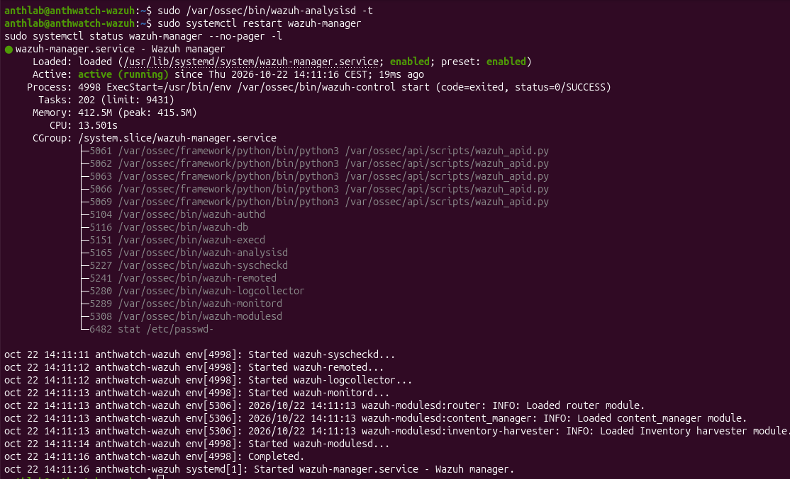
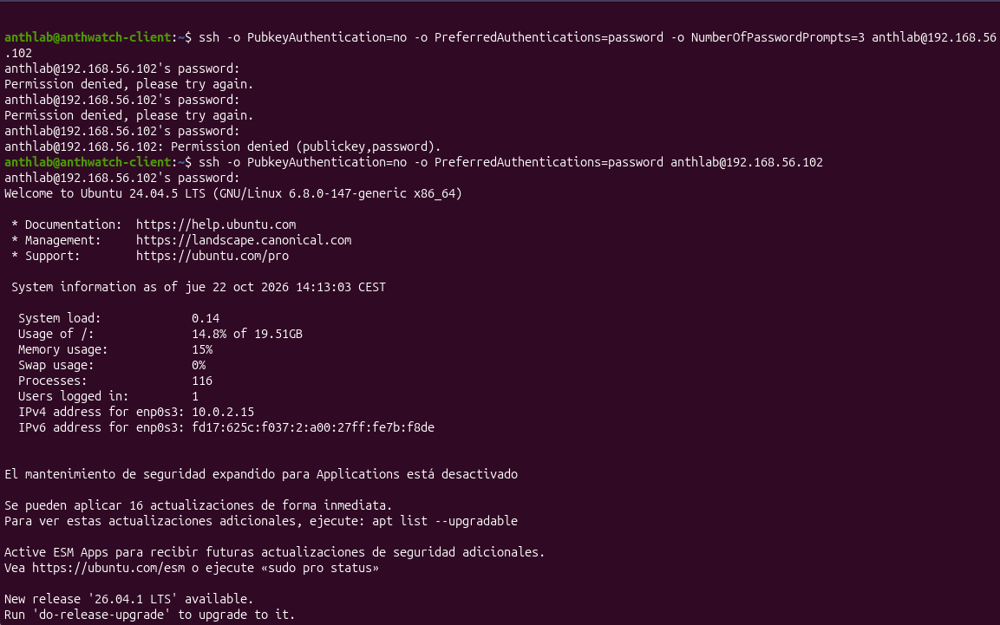
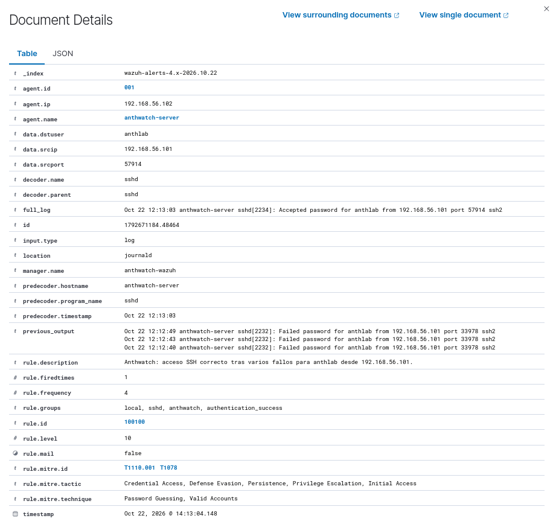

# Caso 003 · Acceso SSH correcto tras varios fallos

[Volver al README](../../README.md)

Creé la regla `100100` para detectar un acceso SSH correcto tras tres fallos de la misma cuenta e IP.  
La validé primero con pruebas positivas y negativas en `wazuh-logtest` y después con SSH real: alerta en una secuencia de 23 segundos.  
La revalidación posterior me enseñó a comprobar cómo llegan los registros, además de revisar la regla; lo explico en [lo que aprendí al cambiar a auth.log](../validaciones/caso-003-auth-log/README.md).

**Fecha:** 22/10/2026.  
**Estado:** regla propia probada con registros de muestra y validada con conexiones reales del laboratorio.  
**Clasificación:** detección correcta de una simulación autorizada.  
**Hora de las VMs:** ajustada a Europe/Madrid con NTP antes de esta prueba.

## Revisión del 24/10/2026

La [revalidación posterior](003-revalidacion.md) incorpora entradas, salidas completas, hashes, controles por identidad y una espera declarada de 130,003 s (132,122 s entre marcas). También documenta el cambio de fuente a auth.log y la corrección de rsyslog. Este informe conserva el escenario histórico con journald y sus capturas; los límites de aquella captura temporal no describen la evidencia adicional posterior.

## Objetivo y alcance

Quería reunir en una alerta los fallos de contraseña y el acceso correcto posterior. Fijé el escenario en tres fallos de la misma cuenta e IP, seguidos de un éxito dentro de 120 segundos.

| Componente | Dirección | Función |
| --- | --- | --- |
| `anthwatch-client` | `192.168.56.101` | Origen de los intentos |
| `anthwatch-server` | `192.168.56.102` | Servidor SSH, agente `001` |
| `anthwatch-wazuh` | `192.168.56.103` | Wazuh 4.14.9, análisis y consulta |

Usé la cuenta existente `anthlab` y las tres VMs del laboratorio. Introduje las contraseñas manualmente.

## Detección implementada

La [regla versionada](../../rules/anthwatch_ssh_rules.xml) tiene ID `100100`, nivel `10`, `frequency="4"` y `timeframe="120"`.

- El evento actual debe coincidir con `5715`: autenticación correcta.
- El historial consultado corresponde a `5760`: fallo de contraseña.
- `same_srcip` mantiene la asociación con la IP de origen.
- `same_user` mantiene la asociación con la cuenta decodificada en `dstuser` en estas muestras.
- El diseño mantiene el alcance por agente con `global_frequency` deshabilitado.

Comprobé el umbral con dos secuencias: tres fallos más éxito activaron mi regla; dos fallos más éxito terminaron en la regla base de acceso correcto. Añadí las etiquetas MITRE `T1110.001` y `T1078`.

## Validación previa con wazuh-logtest

Primero revisé las reglas instaladas y la decodificación: `Failed password` activa `5760` y `Accepted password` activa `5715`. Comprobé que ambos mensajes contenían `dstuser` y `srcip`. Guardé la regla local y abrí una sesión nueva de logtest para cada escenario, antes de reiniciar el manager.

Los [registros y las instrucciones reproducibles](../../tests/caso-003/README.md) permiten repetir las comprobaciones.

| Escenario | Resultado observado | Evidencia |
| --- | --- | --- |
| Tres fallos + éxito, misma cuenta e IP | `100100`, nivel 10 | [Positiva](../capturas/003-logtest-positivo.png) |
| Dos fallos + éxito | `5715`, nivel 3 | [Umbral](../capturas/003-logtest-dos-fallos.png) |
| Tres fallos para `anthlab`, éxito de `otro_usuario` | `5715`, sin correlación propia | [Otro usuario](../capturas/003-logtest-otro-usuario.png) |
| Tres fallos desde `.101`, éxito desde `.104` | `5715`, sin correlación propia | [Otra IP](../capturas/003-logtest-otra-ip.png) |
| Éxito tras la espera indicada de 130 segundos | `5715`, sin correlación propia | [Fuera de ventana](../capturas/003-logtest-fuera-ventana.png) |
| Éxito sin fallos previos, sesión nueva | `5715`, nivel 3 | [Éxito aislado](../capturas/003-logtest-exito-solo.png) |
| Tres fallos sin éxito todavía | Tres `5760`, sin `100100` | Salida completa compartida de la prueba positiva; control observado como prefijo |

Las muestras y sus resultados están separados de las evidencias de la simulación real.

## Despliegue realizado

Guardé la regla en `/var/ossec/etc/rules/anthwatch_ssh_rules.xml`. Validé la configuración, reinicié el manager y comprobé su estado:

```bash
sudo /var/ossec/bin/wazuh-analysisd -t
sudo systemctl restart wazuh-manager
sudo systemctl status wazuh-manager --no-pager -l
```

La validación terminó sin mensajes de error y el servicio quedó `active (running)`.



Para reproducir el despliegue desde este repositorio, copiar el XML al directorio local de reglas del manager, revisar colisiones de ID y conservar fuera de ese directorio cualquier copia anterior. Ejecutar la validación antes de reiniciar. La validación se completa con los eventos reales de los agentes descritos a continuación.

## Simulación con conexiones reales

En la terminal de `anthwatch-client` ejecuté:

```bash
ssh -o PubkeyAuthentication=no -o PreferredAuthentications=password -o NumberOfPasswordPrompts=3 anthlab@192.168.56.102
```

Introduje una contraseña incorrecta tres veces y la conexión terminó con `Permission denied`. Después abrí otra conexión e introduje la contraseña correcta dentro de la ventana:

```bash
ssh -o PubkeyAuthentication=no -o PreferredAuthentications=password anthlab@192.168.56.102
```



## Evidencia en Wazuh

La alerta muestra `agent.id: 001`, `agent.name: anthwatch-server`, `data.dstuser: anthlab`, `data.srcip: 192.168.56.101`, `location: journald` y decodificador `sshd`.

Transcripción de los tres registros visibles en `previous_output`, ordenados cronológicamente, y del acceso correcto visible en `full_log`:

```text
Oct 22 12:12:40 anthwatch-server sshd[2232]: Failed password for anthlab from 192.168.56.101 port 33978 ssh2
Oct 22 12:12:43 anthwatch-server sshd[2232]: Failed password for anthlab from 192.168.56.101 port 33978 ssh2
Oct 22 12:12:49 anthwatch-server sshd[2232]: Failed password for anthlab from 192.168.56.101 port 33978 ssh2
Oct 22 12:13:03 anthwatch-server sshd[2234]: Accepted password for anthlab from 192.168.56.101 port 57914 ssh2
```

Calculé **23 segundos entre el primer fallo y el éxito** con las marcas de los mensajes originales. Los tres fallos comparten PID y puerto; el éxito pertenece a otra conexión. Usé esos campos para distinguir los fallos de contraseña de las conexiones SSH.

**Ajusté la hora de las tres VMs antes del caso 003**, configurando Europe/Madrid y NTP. La terminal muestra **14:13:03 CEST** y el dashboard **22/10/2026 14:13:04.148**. El colector de journald de Wazuh 4.14.9 formatea el mensaje en UTC mediante `gmtime_r`: **12:13:03** en `full_log` equivale a **14:13:03 CEST**. Documenté esta conversión en la [revisión del código y las fuentes](../evidencias/README.md#representación-horaria-de-journald-en-wazuh-4149). Calculé los 23 segundos entre mensajes de la misma fuente. Véase [configuración horaria](../estado-del-laboratorio.md#configuración-horaria).



## Consultas para revisar el caso

En Threat Hunting / Events, seleccionar un intervalo absoluto que incluya el 22/10/2026 de 14:10 a 14:16 en Europe/Madrid y aplicar:

```text
agent.name:"anthwatch-server" AND rule.id:100100
```

Para ampliar a los eventos de la cuenta y del origen:

```text
agent.name:"anthwatch-server" AND data.srcip:"192.168.56.101" AND data.dstuser:"anthlab" AND rule.groups:sshd
```

Revisar `previous_output`, `full_log`, identidad y marcas temporales. Las consultas permiten repetir la revisión mientras los eventos sigan retenidos.

## Decisión N1

Cerré el [ticket simulado SOC-003](../tickets/SOC-003.md) como prueba autorizada: la alerta detectó la secuencia que había generado con mi cuenta. No apliqué contención ni hice un escalado real.

En un caso real comprobaría la autorización del acceso, el uso habitual de la cuenta y la IP, los privilegios y la actividad posterior. Escalaría a N2 si el usuario niega el acceso, el origen no se justifica o aparecen acciones sospechosas. Con ese contexto decidiría la prioridad operativa, además de revisar el nivel 10 de la regla.

## Límites de la validación

- Cobertura: secuencias documentadas en Wazuh 4.14.9; quedan fuera otras variantes de autenticación, umbrales superiores, pérdida o reordenación de eventos, aislamiento entre agentes y actividad posterior de procesos.
- Evidencia: capturas y transcripciones, sin exportación completa del índice. La captura del control temporal conserva el resultado final, sin una medición independiente de la espera.
- Interpretación: las etiquetas MITRE y el nivel de la regla describen la detección; el contexto autorizado permite cerrar el caso. No se ha medido una tasa general de falsos positivos ni se confirma una cuenta comprometida.
- Tiempo: el ajuste de las VMs está completado. El control adicional del caso 002, recogido después de esta prueba, conserva journal con zona explícita `+02:00` y su correspondencia en Wazuh; las [evidencias originales](../evidencias/README.md) incluyen también `timedatectl` de las tres VMs con reloj sincronizado y NTP activo.
- Umbral: las pruebas de tres y dos fallos validan el escenario; `rule.firedtimes` y `frequency` no se utilizan como conteo de conexiones.

## Siguiente paso

El [Hunt 001](../hunts/001-ssh-y-sudo.md) amplía el análisis a SSH y sudo y revisa la calidad de los datos. El siguiente paso es ampliar la telemetría de procesos y contrastar Filebeat y los documentos del índice con `_id`. Windows sigue aplazado por el límite de 16 GB de RAM del portátil.

## Referencias

- [Sintaxis de reglas de Wazuh](https://documentation.wazuh.com/current/user-manual/ruleset/ruleset-xml-syntax/rules.html).
- [Pruebas con wazuh-logtest](https://documentation.wazuh.com/current/user-manual/ruleset/testing.html).
- [Reglas personalizadas](https://documentation.wazuh.com/current/user-manual/ruleset/rules/custom.html).
