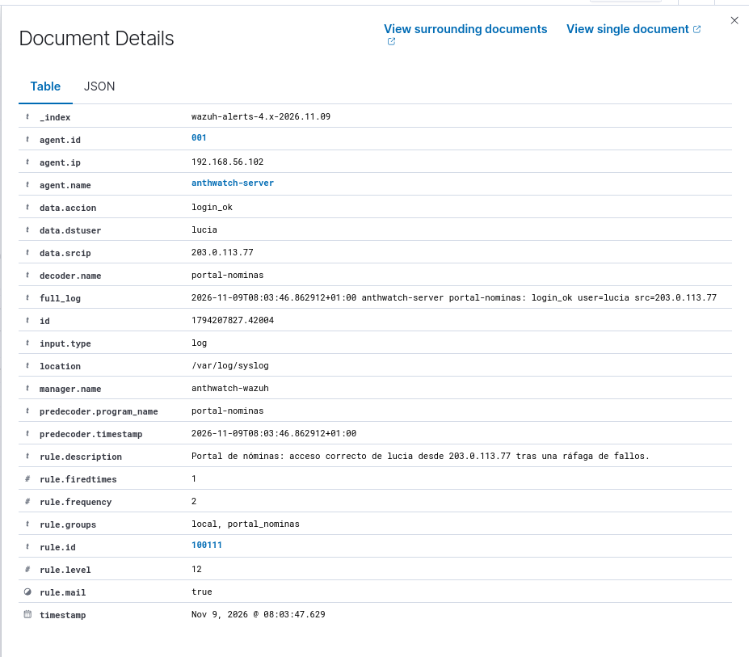

# Caso 004 · Detección y triaje en un portal de nóminas simulado

[Índice de documentación](../README.md)

## Resumen

- **Objetivo:** Incorporar y correlacionar registros de un portal simulado.
- **Método:** Adapté el material de clase, amplié el decodificador y probé reglas con logtest y el agente.
- **Resultado:** Ráfaga, acceso posterior y exportación externa detectados en vivo.
- **Límites:** Correlación por IP, sin exigir la misma cuenta; una exportación externa autorizada también alerta.

## Contexto

Probé cómo incorporar a Anthwatch una fuente de aplicación que Wazuh no decodificaba. Usé Wazuh 4.14.9, instalado directamente en `anthwatch-wazuh`, y el agente `001` de `anthwatch-server`. Adapté el escenario de clase al laboratorio. El decodificador inicial y los registros sintéticos proceden de ese ejercicio. Completé las reglas y comprobé su comportamiento con el agente de Anthwatch. La [salida completa de logtest](../evidencias/caso-004/salida-todo.txt) conserva los 32 eventos de SSH y del portal.

## Decodificación y detección

El [decodificador](../../decoders/ic_portal_nominas_decoder.xml) identifica el programa `portal-nominas` y extrae la acción, la cuenta y la IP de origen. Para una exportación extrae también el número de registros. La regla raíz del portal usa `100104` porque el [caso de SSH](003-ssh-fallos-seguidos-de-exito.md) ya utiliza `100100`.

| Regla | Nivel | Condición |
| --- | ---: | --- |
| `100101`, `100102`, `100103` | 5, 3, 3 | Fallo de acceso, acceso correcto y exportación, respectivamente |
| `100110` | 10 | Cinco fallos en 120 segundos desde la misma IP. MITRE ATT&CK `T1110`. |
| `100111` | 12 | Acceso correcto desde una IP que activó `100110` en los últimos 600 segundos |
| `100112` | 10 | Exportación desde fuera de la red del escenario, `10.20.0.0/24` |

Las [reglas XML](../../rules/ic_portal_nominas_rules.xml) pasaron `wazuh-analysisd -t`. En una sesión de `wazuh-logtest`, la alerta `100110` apareció en el quinto fallo. Probé un acceso correcto desde otra IP, que quedó en `100102`, y después un acceso desde la IP de los fallos, que activó `100111`. La correlación usa la IP de origen aunque cambie la cuenta.

## Cronología del ejercicio

| Hora local | Fuente | Evidencia |
| --- | --- | --- |
| 07:53:02 | Portal | `director` exportó 3 registros desde una IP externa autorizada. La alerta `100112` fue un benigno esperado. |
| 09:08:01–09:09:30 | SSH | Intentos como `admin` y `root` desde `203.0.113.77`, con un cierre durante la autenticación. |
| 09:12:02–09:15:20 | Portal | Diez fallos desde esa IP. La primera `100110` coincide con el quinto fallo, a las 09:12:28. |
| 09:16:05 | Portal | Acceso correcto con `lucia` desde la misma IP. |
| 09:17:12 | Portal | La cuenta `lucia` exportó 4812 registros desde esa IP. |

La secuencia sugiere un posible compromiso. El registro identifica la cuenta y la IP. Para atribuir la actividad a una persona habría que contrastar la sesión con evidencia adicional, por ejemplo el dispositivo o el registro de MFA.

Al reproducir el fichero completo apareció otra `100110` a las 09:15:20. Solo hay cuatro fallos desde esa IP en los 120 segundos de la cronología original, incluido el evento actual. Logtest recibió todo el fichero de golpe y calculó la ventana con el tiempo de procesamiento.

## Prueba en vivo

El 9 de noviembre de 2026 generé nueve mensajes de prueba con `logger` en `anthwatch-server`. El agente los recogió de `/var/log/syslog` y el manager emitió estas alertas. Las cuentas, las acciones y los datos de nóminas son parte del escenario ficticio.

| Hora local del evento (CET) | Hora UTC de la alerta | Regla | Nivel |
| --- | --- | --- | ---: |
| 08:03:40 | 07:03:41.632 | `100110` | 10 |
| 08:03:46 | 07:03:47.629 | `100111` | 12 |
| 08:03:49 | 07:03:49.943 | `100112` | 10 |

[Alertas JSONL del manager](../evidencias/caso-004/vivo.jsonl) · [Manifiesto SHA-256](../evidencias/caso-004/SHA256SUMS)

## Mantenimiento y mejora propuesta

El XML del repositorio utiliza `same_srcip`, el nombre actual de la etiqueta de comparación de IP. Las evidencias de noviembre corresponden al alias `same_source_ip` utilizado durante la prueba. La documentación de Wazuh confirma su equivalencia. La revisión del XML requiere validación en el manager antes de desplegarla. [Sintaxis de Wazuh](https://documentation.wazuh.com/current/user-manual/ruleset/ruleset-xml-syntax/rules.html#same-srcip)

Para adaptar `100112` a un entorno operativo, la red interna se definiría según ese entorno y se mantendría una lista CDB de orígenes autorizados. La excepción del director también debe comprobar la cuenta y las condiciones de autorización. El caso actual conserva la detección de cualquier exportación externa y su clasificación posterior durante el triaje. La lista CDB es una mejora propuesta pendiente de implementar y probar. [Listas CDB de Wazuh](https://documentation.wazuh.com/current/user-manual/ruleset/cdb-list.html)
