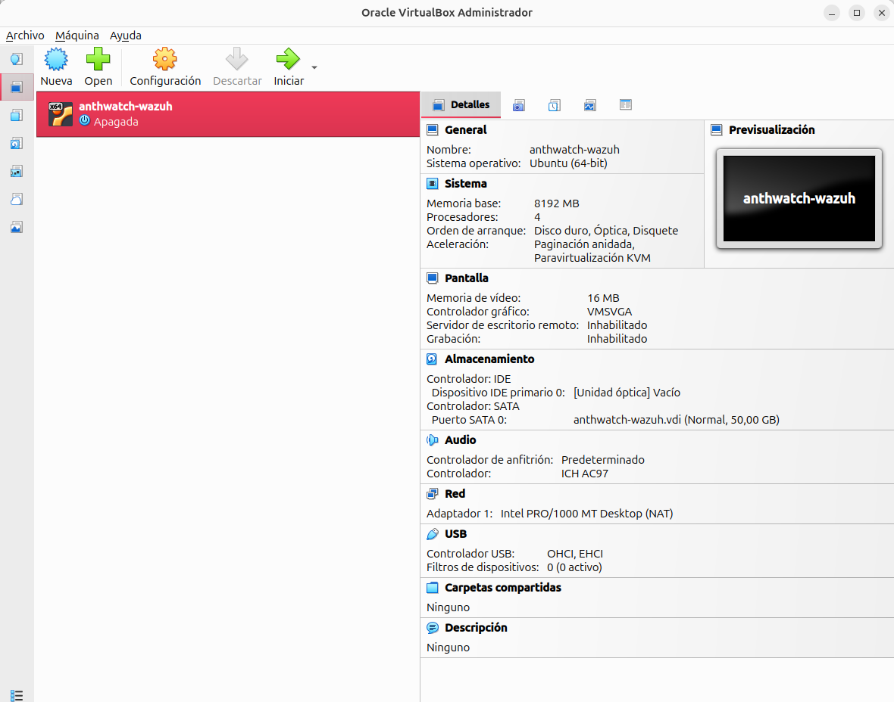
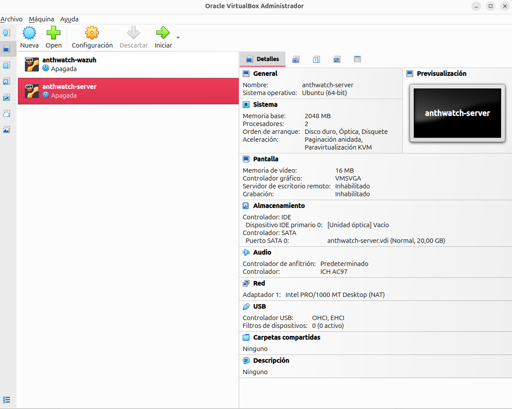
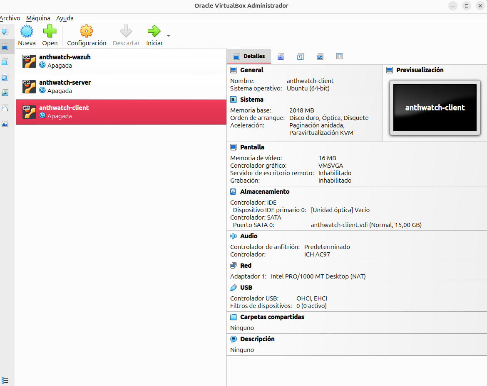
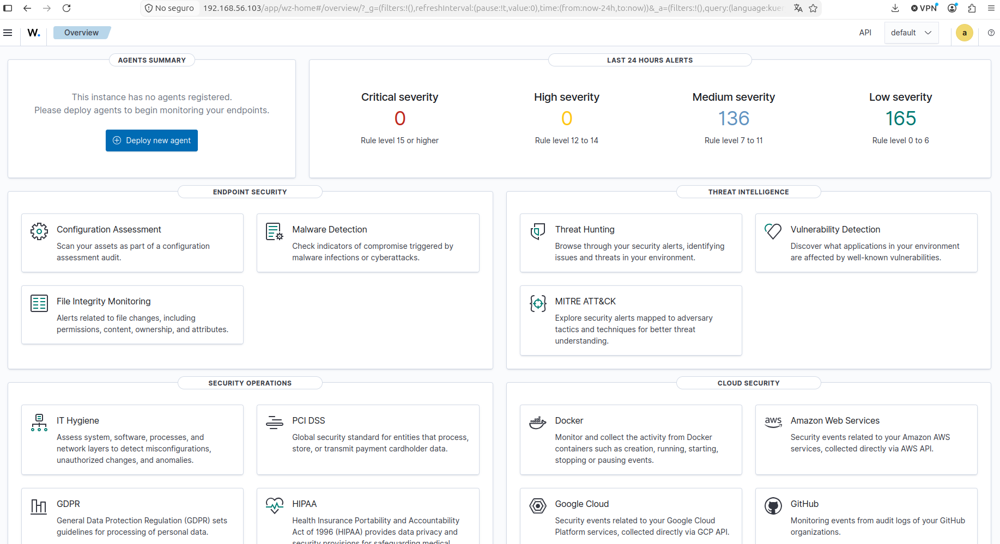
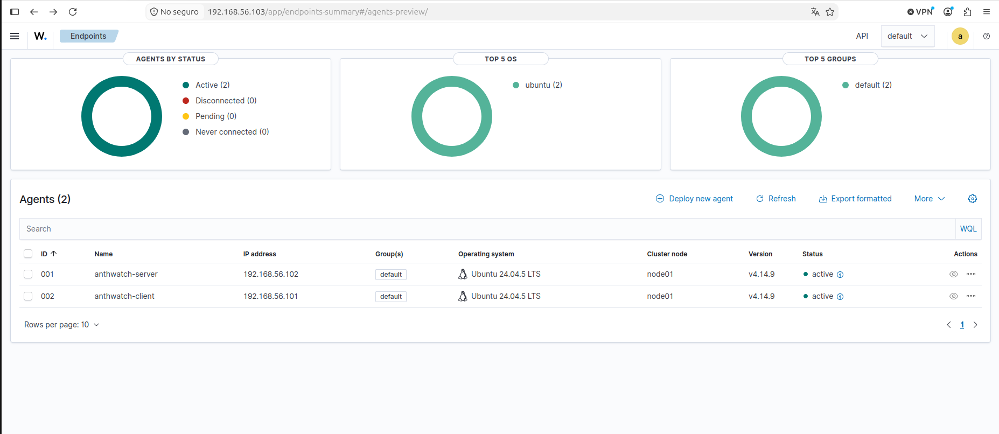

# Estado y montaje de Anthwatch

[Volver al README](../README.md)

Mi laboratorio personal de operaciones de seguridad con Wazuh.

**Estado:** Wazuh 4.14.9 está instalado y los agentes de `anthwatch-server` y `anthwatch-client` aparecen activos en el dashboard. Las tres máquinas se comunican por la red solo-anfitrión y se administran por SSH. Hay tres casos SSH documentados: eventos individuales, correlación con usuario inexistente y regla propia de fallos seguidos de éxito con una cuenta existente.

## Sobre el proyecto

Utilizo Anthwatch para practicar el trabajo de un analista SOC N1: revisar eventos, investigar alertas y documentar los resultados.

En cada caso analizo qué ha pasado, cómo lo ha detectado Wazuh y qué decisión justifican las evidencias disponibles.

Las máquinas utilizan una red solo-anfitrión separada de mi red doméstica. Las pruebas se realizan contra mis propias máquinas virtuales y con cuentas del laboratorio.

## Entorno

| Componente | Estado |
| --- | --- |
| VirtualBox | Instalado y con las tres máquinas creadas |
| Ubuntu Server | Instalado en las tres máquinas |
| Wazuh | Versión 4.14.9 instalada; dashboard accesible |
| Agentes Wazuh | `anthwatch-server` y `anthwatch-client` activos |
| Administración | Acceso por SSH desde el portátil |

Las versiones y los pasos de configuración están documentados en `instalacion/`.

## Máquinas instaladas

Las tres máquinas virtuales ya están creadas en VirtualBox y tienen Ubuntu Server instalado. Sus funciones y recursos son:

| Máquina | Función | IP de laboratorio | CPU virtuales | RAM | Disco |
| --- | --- | --- | ---: | ---: | ---: |
| `anthwatch-wazuh` | Servidor Wazuh, indexador y panel en una misma VM | `192.168.56.103` | 4 | 8 GiB | 50 GB |
| `anthwatch-server` | Ubuntu Server con SSH y agente de Wazuh | `192.168.56.102` | 2 | 2 GiB | 20 GB |
| `anthwatch-client` | Ubuntu Server con agente de Wazuh, desde el que genero los intentos de acceso | `192.168.56.101` | 1 | 2 GiB | 15 GB |

Las máquinas están conectadas entre sí mediante `vboxnet0` (adaptador solo-anfitrión). Conservan un adaptador NAT para instalar y actualizar paquetes. Las evidencias de los casos 001 y 002 no confirman su estado durante las pruebas.

Wazuh está desplegado en `anthwatch-wazuh` con el manager, el indexador y el dashboard en una misma VM. Los otros dos equipos tienen instalado el agente 4.14.9 y aparecen como activos. La conexión de los agentes está verificada; la recogida de eventos SSH y las reglas de fallo y acceso correcto están verificadas. La regla `5712` de nivel 10 también está verificada para intentos repetidos con usuario inexistente.

### Capturas de configuración

Estas capturas muestran la configuración de las máquinas en VirtualBox:

**anthwatch-wazuh**

**anthwatch-server**

**anthwatch-client**

## Wazuh y agentes conectados

El dashboard está disponible en `https://192.168.56.103` desde el portátil.

### Dashboard de Wazuh

Acceso al dashboard tras completar la instalación, antes de registrar los agentes:

### Agentes activos

La comprobación del 21 de octubre de 2026 muestra los dos agentes activos, sin agentes desconectados, pendientes ni que nunca hayan conectado:

| Agente | ID | IP | Versión | Estado |
| --- | --- | --- | --- | --- |
| `anthwatch-server` | `001` | `192.168.56.102` | 4.14.9 | Activo |
| `anthwatch-client` | `002` | `192.168.56.101` | 4.14.9 | Activo |

El dashboard muestra dos agentes porque corresponden a los dos equipos monitorizados; `anthwatch-wazuh` actúa como servidor central.

## Primera versión

El [primer caso de autenticación SSH](casos/001-autenticacion-ssh.md) está documentado: se realizaron tres intentos con contraseña incorrecta y un acceso correcto posterior desde el mismo cliente y con el mismo usuario del laboratorio. Se verificaron las reglas `5760` (fallo, nivel 5) y `5715` (acceso correcto, nivel 3).

Estado de la primera versión:

- [x] Crear las tres máquinas virtuales con los recursos indicados.
- [x] Instalar Ubuntu Server 24.04.5 LTS en las tres máquinas.
- [x] Configurar la red solo-anfitrión y comprobar la comunicación entre las máquinas.
- [x] Habilitar la administración por SSH desde el portátil.
- [x] Instalar Wazuh y conectar los agentes de `anthwatch-server` y `anthwatch-client`.
- [x] Verificar la recogida de eventos de autenticación SSH.
- [x] Generar una secuencia de fallos y comprobar los eventos que produce.
- [x] Realizar un acceso correcto y compararlo con los fallos anteriores.
- [x] Escribir el informe con las evidencias y la conclusión.

Las reglas asocian los eventos con [T1110.001 — Password Guessing](https://attack.mitre.org/techniques/T1110/001/) y [T1078 — Valid Accounts](https://attack.mitre.org/techniques/T1078/). Los casos 002 y 003 amplían este punto de partida con correlación automática y una regla propia.

## Segundo caso: intentos SSH repetidos

El [caso 002](casos/002-usuario-inexistente-repetido.md) verifica la alerta `5712`, de nivel 10, desde `anthwatch-client` hacia `anthwatch-server` con el usuario `soc_prueba_inexistente`. La regla correlaciona eventos `5710` de la misma IP en 120 segundos, con un umbral configurado de ocho eventos.

- [x] Revisar la regla instalada y sus condiciones.
- [x] Generar la prueba y observar la alerta correlacionada.
- [x] Revisar un control posterior con eventos individuales y sin nueva `5712` en la ventana consultada.
- [x] Documentar evidencias, limitaciones y decisión en el informe y el ticket simulado SOC-002.

El control se repitió con journal: una conexión identificada por PID `2044` y puerto `34332` produjo dos eventos `5710`, sin nueva `5712` en la ventana conservada. El informe incluye capturas y el [journal original](evidencias/caso-002-control-journal.txt). El control histórico de cuatro eventos se mantiene separado.

## Ficha de investigación

Los informes siguen una misma estructura y recogen:

- Qué ocurrió: equipo, IP de origen, usuario y horarios.
- Qué alerta aparece y qué evidencias la respaldan.
- Qué se simula y qué demuestran los registros.
- Técnica MITRE asociada.
- Qué prioridad se asigna y por qué.
- Qué se confirma y qué información falta.
- Qué medidas se proponen y qué hallazgos justifican un escalado.

El [caso 001](casos/001-autenticacion-ssh.md) aplica esta estructura: objetivo, procedimiento, cronología, evidencias, análisis, límites y decisión.

## Tercer caso: regla propia de fallos seguidos de éxito

El [caso 003](casos/003-ssh-fallos-seguidos-de-exito.md) valida `100100`, nivel 10: tres fallos y un éxito desde `.101` hacia `.102`, misma cuenta `anthlab`, en 23 segundos. Se probaron registros de muestra con `wazuh-logtest` antes de reiniciar el manager y se conservaron controles de umbral, identidad y tiempo. El informe, XML, muestras, capturas y ticket están versionados.

## Hunt y revalidación

El [Hunt 001](hunts/001-ssh-y-sudo.md) documenta SSH seguido de sudo y corrige el inventario a 28 comandos: 26 `5402` y 2 `5403`. La exportación conserva el cambio de journald a `/var/log/auth.log`; no debe aplicarse al nuevo formato ISO la corrección horaria histórica de journald.

La [revalidación del caso 003](casos/003-revalidacion.md) conserva resultados completos de logtest para positiva, otra IP, otro usuario y control temporal con espera declarada de 130,003 s (132,122 s entre marcas). El XML recogido y el del repositorio tienen la misma lógica. Conservé también los [originales de la corrección de rsyslog y la nueva prueba real](validaciones/caso-003-auth-log/README.md).

## Configuración horaria

La hora de las tres VMs se ajustó antes del caso 003; las salidas de `timedatectl` confirman Europe/Madrid, reloj sincronizado y NTP activo. La diferencia de dos horas entre `full_log` y la hora local se debe al formato UTC del colector de journald de Wazuh 4.14.9. Los archivos originales, las comparaciones y las líneas del código están en [evidencias](evidencias/README.md).

## Próximas fases

El primer hunt está documentado y la [revisión histórica del duplicado](hunts/hunt-001/repeticiones-exportacion.md) se amplió el 26/10: 68 parejas documentales confirmadas y causa histórica indeterminada por falta de logs de Filebeat de madrugada. Mi siguiente prioridad es ampliar la cobertura de procesos. Windows queda aplazado por los 16 GB de RAM del portátil. El alcance y la cobertura que falta verificar se recogen en la [hoja de ruta](hoja-de-ruta.md).

Las ampliaciones de integridad de archivos, usuarios y procesos servirán para enriquecer las investigaciones posteriores; la primera revisión de actividad con `sudo` ya está documentada.

## Documentación

Documentación disponible:

- [Máquinas virtuales en VirtualBox](instalacion/virtualbox.md).
- [Instalación de Ubuntu Server y administración por SSH](instalacion/ubuntu-server.md).
- [Instalación de Wazuh y conexión de agentes](instalacion/wazuh.md).
- [Configuración y comprobación de la red](arquitectura/red-del-laboratorio.md).
- [Diagrama de red](arquitectura/diagrama-red.png).
- [Caso 001: fallos de autenticación SSH y acceso correcto](casos/001-autenticacion-ssh.md).
- [Procedimiento N1: análisis de autenticación SSH](playbooks/ssh-autenticacion.md).
- [Ticket simulado SOC-001](tickets/SOC-001.md).
- [Caso 002: correlación de intentos SSH con usuario inexistente](casos/002-usuario-inexistente-repetido.md).
- [Ticket simulado SOC-002](tickets/SOC-002.md).
- [Caso 003: regla propia de fallos seguidos de éxito](casos/003-ssh-fallos-seguidos-de-exito.md).
- [Ticket SOC-003](tickets/SOC-003.md) · [Regla XML](../rules/anthwatch_ssh_rules.xml) · [Muestras y controles](../tests/caso-003/README.md).

Los documentos de instalación recogen el estado actual; los detalles aún no verificados están indicados como pendientes. Los tres informes, el procedimiento de análisis N1 y sus tickets simulados están disponibles. Los casos pendientes figuran en la [hoja de ruta](hoja-de-ruta.md).

Mi [portfolio](https://anthlab.github.io/) presenta mis proyectos, incluido Anthwatch.

## Referencias

- [Guía de inicio rápido de Wazuh](https://documentation.wazuh.com/current/quickstart.html)
- [Detección de fuerza bruta con Wazuh](https://documentation.wazuh.com/current/proof-of-concept-guide/detect-brute-force-attack.html)
- [Documentación de VirtualBox](https://docs.oracle.com/en/virtualization/virtualbox/index.html)

