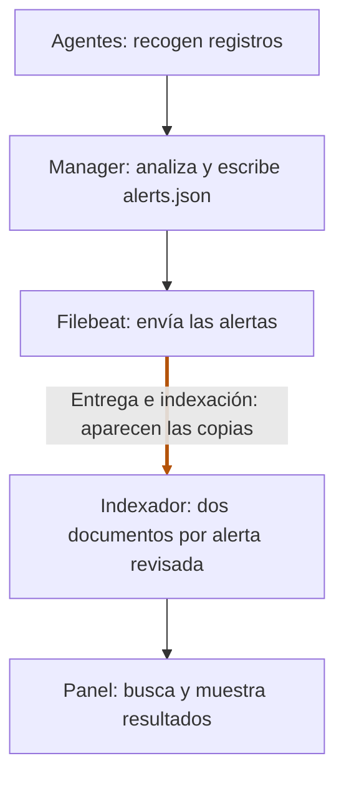

# Hunt 001 · SSH y sudo

[Volver al README](../../README.md) · [Informe completo](hunt-001/README.md) · [Ticket](../tickets/HUNT-001.md)

## Resumen

- **Pregunta:** ¿qué actividad con privilegios siguió a los accesos SSH y por qué veía registros repetidos?
- **Método:** crucé logs y CSV, consulté los documentos del indexador y contrasté sus identificadores con los archivos del manager.
- **Hallazgo:** enlacé SSH y sudo en la prueba controlada, corregí el inventario a 28 comandos y confirmé 68 parejas de documentos para alertas emitidas una sola vez en los archivos conservados.
- **Límites:** la atribución SSH → sudo está respaldada para la prueba controlada; faltan los logs de Filebeat de madrugada y los originales del manager contienen prefijos NUL documentados.
- **Decisión:** cerré la revisión sin actividad no autorizada identificada; la duplicación está confirmada y su causa concreta sigue indeterminada.

## Cinco conceptos para seguir el hunt

| Concepto | Qué significa aquí |
| --- | --- |
| Alerta y documento | El manager genera una alerta; el indexador guarda un documento que la representa. Una alerta puede acabar guardada dos veces. |
| `id` y `_id` | `id` identifica la alerta del manager; `_id` identifica cada documento del índice. Aquí dos `_id` distintos compartían el mismo `id`. |
| Índice | Conjunto de documentos guardados en el indexador. Los índices de alertas revisados llevan una fecha UTC en el nombre. |
| Filebeat | Servicio que lee las alertas del manager y las envía al indexador; puede reenviar datos si falta una confirmación. |
| `_bulk` | Petición para enviar varias operaciones de indexación en un lote. El error `EOF` durante la parada no indica qué alertas iban dentro. |

## Por dónde pasan los datos

Los agentes recogen registros de las máquinas. El manager los analiza y escribe las alertas; Filebeat las envía al indexador, donde quedan guardadas para consultarlas desde el panel.

En los dos archivos históricos del manager encontré **una aparición de cada una de las 68 alertas**; en el índice había **dos documentos por alerta**. Eso sitúa la duplicación después de la emisión conservada del manager, en el tramo de entrega e indexación. El contraste no identifica qué componente o reintento produjo las copias. El panel consulta esos documentos, así que puede mostrar más resultados aunque el manager haya emitido una sola alerta.

Con el panel revisaba las alertas; para comprobar la repetición necesitaba comparar los dos documentos y sus `_id`, y agrupar por `id` en todos los índices consultados. Por eso pasé a Dev Tools y consulté directamente el indexador. El [análisis completo](hunt-001/repeticiones-exportacion.md#por-qué-usé-dev-tools) explica las consultas y sus límites.

## Informes y evidencias

- [Informe, fuentes, cronología y límites](hunt-001/README.md).
- [Repeticiones del CSV e hipótesis de entrega](hunt-001/repeticiones-exportacion.md).
- [Inventario histórico de 26 alertas](hunt-001/revision-sudo.md) y [exportación corregida de 28 comandos](../evidencias/hunt-001/sudo-eventos.csv).
- [Evidencias originales y verificación](../evidencias/hunt-001/README.md).
- [Revalidación real con auth.log](../validaciones/caso-003-auth-log/README.md) y [controles completos del 24/10](../casos/003-revalidacion.md).
